# CSS Flexbox Guide (with Media Queries)

**Topics covered:** Flexbox Basics, Flex Container Properties, Flex Item Properties, Media Queries, Breakpoints, Responsive Layouts, 4 Mini Projects

Yeh guide students ke liye hai. Har property ko **definition, real-life analogy, image (browser output), syntax aur examples** ke sath explain kiya gaya hai. Tamam images asal browser mein render kar ke li gayi hain, yaani jo image mein nazar aa raha hai bilkul wahi aap ke browser mein aayega.

---

## Table of Contents

1. [Flexbox Kya Hai?](#1-flexbox-kya-hai)
2. [Flexbox Kyun Use Hota Hai?](#2-flexbox-kyun-use-hota-hai)
3. [Flexbox Kaise Shuru Karein](#3-flexbox-kaise-shuru-karein)
4. [Flexbox Terminology](#4-flexbox-terminology)
5. [display: flex Lagane Ke Baad Kya Hota Hai?](#5-display-flex-lagane-ke-baad-kya-hota-hai)
6. [Flex Container Properties](#6-flex-container-properties)
7. [Flex Item Properties](#7-flex-item-properties)
8. [Media Queries](#8-media-queries)
9. [Common Layout Patterns](#9-common-layout-patterns)
10. [Common Mistakes](#10-common-mistakes)
11. [Quick Cheat Sheet](#11-quick-cheat-sheet)
12. [Mini Projects](#12-mini-projects)
13. [Practice Tasks](#13-practice-tasks)
14. [Useful Resources](#14-useful-resources)

---

## 1. Flexbox Kya Hai?

### Definition
**Flexbox** (Flexible Box Layout) CSS ka ek **layout system** hai. Yeh ek **parent element (Flex Container)** ke andar maujood **child elements (Flex Items)** ko ek **row ya column** mein **arrange, align aur distribute** karta hai, aur available space ko khud-ba-khud taqseem kar leta hai.

Flexbox **one-dimensional** (ek waqt mein sirf ek direction: ya row ya column) layout system hai.

### Real-Life Analogy
Ek **shaadi hall** socho. Hall ka manager chairs ke liye ek hi hukm deta hai:

> *"Sab kursiyan **ek line mein** lagao, **barabar faasle** se, aur **hall ke beech** mein."*

Manager **har kursi ko alag alag** nahi batata ke kahan rakhni hai. Woh sirf **ek rule** deta hai aur sab kursiyan us rule ke mutabiq khud set ho jati hain.

| Shaadi Hall | Flexbox |
|-------------|---------|
| Hall ka manager | **Flex Container** (parent) par likhi hui CSS |
| Kursiyan | **Flex Items** (children) |
| Manager ka hukm | `display: flex`, `justify-content`, `align-items` waghera |
| Kursiyan kam ya zyada ho jayen | Layout khud adjust ho jata hai |

---

## 2. Flexbox Kyun Use Hota Hai?

### Flexbox se Pehle Kya Masail The?

Pehle layout banane ke liye `float`, `inline-block`, `table` aur `position` use hote the. Inke saath yeh masail the:

| Masla | Purana tareeqa | Flexbox ke sath |
|-------|----------------|------------------|
| Element ko **vertically center** karna | `position` + `margin` + `transform` ki hacks | `align-items: center` (1 line) |
| Items ko **barabar faasle** se rakhna | Manually margin calculate karna | `justify-content: space-between` |
| **Equal height** columns | Bohat mushkil, hacks | Khud ba khud (`align-items: stretch`) |
| Items ki **tarteeb badalna** | HTML change karna parta tha | `order` property |
| **Responsive** layout | Bohat saari calculations | `flex-wrap` aur `flex-basis` |
| Float ke baad **clearfix** | Extra CSS hack | Zaroorat hi nahi |

### Flexbox ke Faide

- Layout banana **aasan aur chhota code**
- Items **khud adjust** hote hain (flexible)
- Vertical aur horizontal **alignment aasan**
- **Responsive design** ke liye behtareen
- HTML ka order badle baghair **visual order** badal sakte hain
- Sab modern browsers mein supported

### Flexbox Kahan Use Hota Hai?

| Jagah | Misaal |
|-------|--------|
| Navigation bar | Logo left, menu right |
| Card rows | Courses, products, team members |
| Centering | Login box, popup, loader |
| Forms | Input aur button ek line mein |
| Footer | Links ki row |
| Sidebar + content layout | Dashboard |

### Flexbox vs Grid

| Feature | Flexbox | CSS Grid |
|---------|---------|----------|
| Dimension | **1D** (row ya column) | **2D** (row aur column dono) |
| Best for | Components (navbar, cards row, buttons) | Poore page ka layout |
| Content-first ya Layout-first | Content size ke mutabiq adjust | Pehle grid banti hai, phir content |

> **Yaad rakhne ka tareeqa:** Ek line ka kaam = **Flexbox**. Poori table jaisi grid = **Grid**. Dono ek sath bhi use ho sakte hain.

---

## 3. Flexbox Kaise Shuru Karein

Sirf **2 steps** hain:

1. Un elements ka **parent** select karein jin ko arrange karna hai.
2. Us parent par `display: flex;` likhein.

```html
<div class="container">
  <div class="item">1</div>
  <div class="item">2</div>
  <div class="item">3</div>
</div>
```

```css
.container {
  display: flex;      /* Ab yeh Flex Container hai */
}
```

### Before aur After

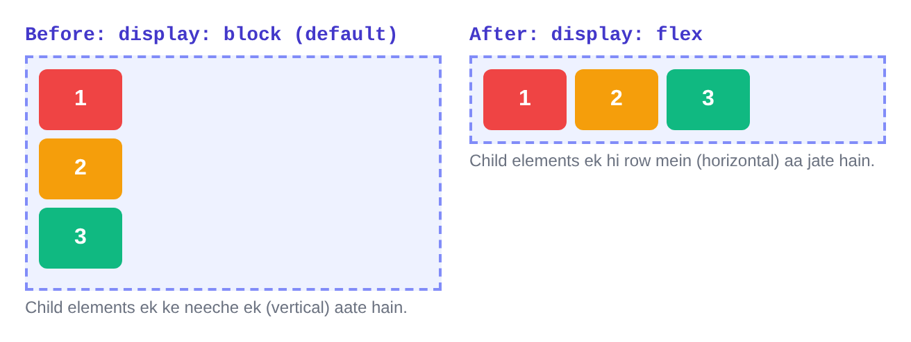

- **Pehle (`display: block`):** Elements ek ke neeche ek (vertical) aate hain.
- **Baad mein (`display: flex`):** Elements ek hi row mein (horizontal) aa jate hain.

### Zaroori Rule

`display: flex` sirf **direct children** ko Flex Items banata hai. **Grandchildren (children ke andar wale elements)** par koi asar nahi parta.

```html
<div class="container">          <!-- Flex Container -->
  <div class="item">             <!-- Flex Item (direct child) -->
    <p>Main flex item nahi hoon</p>   <!-- Normal element -->
  </div>
</div>
```

### display: flex vs display: inline-flex

| Value | Container ka behavior |
|-------|-----------------------|
| `display: flex` | Container **block ki tarah** hota hai (poori width leta hai, nayi line se shuru) |
| `display: inline-flex` | Container **inline ki tarah** hota hai (sirf content jitni width, line mein rehta hai) |

---

## 4. Flexbox Terminology

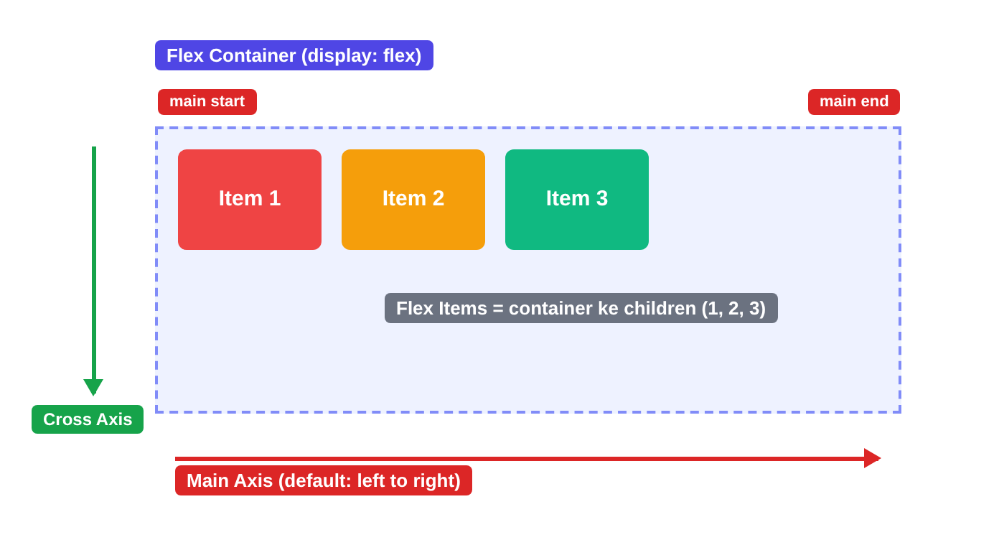

| Term | Matlab |
|------|--------|
| **Flex Container** | Wo parent element jis par `display: flex` lagaya gaya |
| **Flex Items** | Flex Container ke **direct children** |
| **Main Axis** | Wo direction jis mein items **arrange** hote hain (default: left se right) |
| **Cross Axis** | Main axis ke **perpendicular (90 degree)** direction (default: top se bottom) |
| **Main Start / Main End** | Main axis ka shuru aur aakhir |
| **Cross Start / Cross End** | Cross axis ka shuru aur aakhir |

> **Sab se zaroori baat:** Main Axis aur Cross Axis **fixed nahi** hain. `flex-direction` badalne par yeh **aapas mein badal jate hain** (Section 6.8 mein tafseel hai).

---

## 5. `display: flex` Lagane Ke Baad Kya Hota Hai?

Jaise hi aap container par `display: flex` likhte hain, browser children par **in default rules** ko apply kar deta hai. Aap ne kuch aur likha bhi na ho tab bhi yeh sab ho jata hai:

| # | Kya hota hai | Kaun si property (default value) |
|---|--------------|-----------------------------------|
| 1 | Children **ek hi row** mein aa jate hain, left se right | `flex-direction: row` |
| 2 | Children **apne content jitni width** lete hain (poori width nahi) | `flex-basis: auto`, `flex-grow: 0` |
| 3 | Children ki **height container jitni** ho jati hai (agar height set nahi) | `align-items: stretch` |
| 4 | Children **left (main start)** se shuru hote hain | `justify-content: flex-start` |
| 5 | Children **kabhi agli line mein nahi** jate (wrap nahi hote) | `flex-wrap: nowrap` |
| 6 | Jagah kam par children **tang (shrink)** ho jate hain | `flex-shrink: 1` |
| 7 | Children ke beech **koi gap nahi** | `gap: 0` |

### Extra Faide (Jo Khud Ba Khud Hote Hain)

- Children par `float`, `clear` aur `vertical-align` **ka koi asar nahi** hota (ignore ho jate hain).
- `span` jaise **inline elements bhi block jaise** ban jate hain (width aur height accept karte hain).
- Flex Items ke **margins aapas mein collapse nahi** hote.

### Tamam Default Values (Ek Table Mein)

**Container par:**

| Property | Default |
|----------|---------|
| `flex-direction` | `row` |
| `flex-wrap` | `nowrap` |
| `justify-content` | `flex-start` |
| `align-items` | `stretch` |
| `align-content` | `normal` (stretch jaisa) |
| `gap` | `0` |

**Items par:**

| Property | Default |
|----------|---------|
| `order` | `0` |
| `flex-grow` | `0` |
| `flex-shrink` | `1` |
| `flex-basis` | `auto` |
| `align-self` | `auto` |

### Children Kaise Move Aur Align Hote Hain?

Container par properties likh kar aap children ki **position control** karte hain:

| Aap kya chahte hain | Property | Kis axis par kaam karti hai |
|---------------------|----------|------------------------------|
| Items ki **direction** (row ya column) | `flex-direction` | Main axis tay karti hai |
| Items ko **main axis** par move karna | `justify-content` | **Main axis** |
| Items ko **cross axis** par move karna | `align-items` | **Cross axis** |
| Items ko agli line mein bhejna | `flex-wrap` | - |
| Lines ko cross axis par move karna | `align-content` | **Cross axis** (multi-line) |
| Items ke beech faasla | `gap` | Dono |

> **Yaad rakhne ka tareeqa:**
> `justify-content` = **Main axis** (default: left-right)
> `align-items` = **Cross axis** (default: upar-neeche)

---

## 6. Flex Container Properties

Yeh properties **parent (Flex Container)** par likhi jati hain.

| Property | Kaam |
|----------|------|
| `display` | Flex Container banana |
| `flex-direction` | Main axis ki direction |
| `flex-wrap` | Items agli line mein ja sakte hain ya nahi |
| `flex-flow` | `flex-direction` + `flex-wrap` ka shorthand |
| `justify-content` | Main axis par alignment |
| `align-items` | Cross axis par alignment (ek line ke items) |
| `align-content` | Cross axis par **lines** ki alignment |
| `gap` | Items ke darmiyan faasla |

---

### 6.1 `flex-direction`

#### Definition
`flex-direction` **Main Axis ki direction** tay karti hai, yaani items **kis taraf** arrange honge.

#### Real-Life Analogy
Bank mein **line (queue)**. Kabhi log **left se right** khare hote hain, kabhi **upar se neeche** (counter ki taraf), aur kabhi **ulti tarteeb** mein.

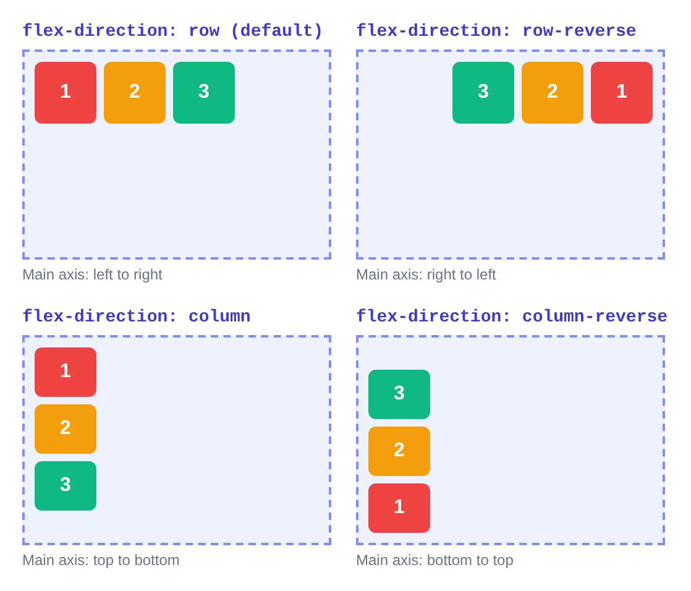

#### Values

| Value | Main Axis ki direction | Items ki tarteeb |
|-------|------------------------|------------------|
| `row` (default) | Left se Right | 1, 2, 3 |
| `row-reverse` | Right se Left | 3, 2, 1 (visual) |
| `column` | Top se Bottom | 1, 2, 3 (neeche ki taraf) |
| `column-reverse` | Bottom se Top | 3, 2, 1 (visual) |

#### Syntax
```css
.container {
  display: flex;
  flex-direction: row | row-reverse | column | column-reverse;
}
```

#### Example 1: Items ko Column Mein Rakhna

```html
<div class="menu">
  <a href="#">Home</a>
  <a href="#">About</a>
  <a href="#">Contact</a>
</div>
```

```css
.menu {
  display: flex;
  flex-direction: column;   /* Links ek ke neeche ek */
  width: 150px;
  gap: 8px;
}
```

**Output:** Teeno links vertical menu ki shakal mein aayenge (sidebar menu).

#### Example 2: Chat Message (Apna Message Right Par)

```html
<div class="message mine">
  
  <p>Assalam o Alaikum!</p>
</div>
```

```css
.message {
  display: flex;
  gap: 8px;
}

.message.mine {
  flex-direction: row-reverse;   /* Image right par, text left par */
}
```

**Output:** HTML mein image pehle likhi hai, lekin `row-reverse` ki wajah se woh right side par aati hai.

#### Example 3: Mobile Par Row Ko Column Banana

```css
.navbar {
  display: flex;
  flex-direction: row;
}

@media (max-width: 768px) {
  .navbar {
    flex-direction: column;     /* Choti screen par ek ke neeche ek */
  }
}
```

**Output:** Bari screen par menu ek row mein, mobile par ek ke neeche ek.

> **Dhyan dein:** `row-reverse` aur `column-reverse` sirf **visual order** badalte hain. Keyboard (Tab key) wali tarteeb HTML wali hi rehti hai. Is liye zaroori content ki tarteeb ke liye in ka bohat zyada use na karein.

---

### 6.2 `justify-content`

#### Definition
`justify-content` items ko **Main Axis** par **align aur distribute** karti hai (default direction mein yeh **horizontal** hota hai).

#### Real-Life Analogy
Ek **bench** par students baithi hain. Teacher kehti hai:
- *"Sab bench ke **shuru** mein baitho"* = `flex-start`
- *"Sab bench ke **aakhir** mein baitho"* = `flex-end`
- *"Sab bench ke **beech** mein baitho"* = `center`
- *"Pehli bilkul shuru mein, aakhri bilkul aakhir mein, baaki beech mein **barabar faasle** se"* = `space-between`

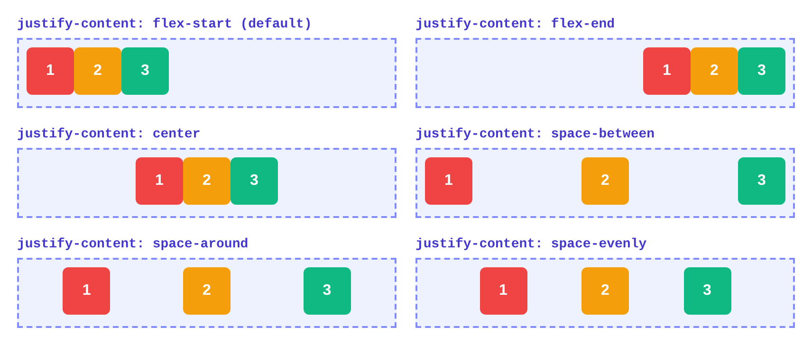

#### Values

| Value | Items kahan jate hain |
|-------|------------------------|
| `flex-start` (default) | Main axis ke **shuru** mein |
| `flex-end` | Main axis ke **aakhir** mein |
| `center` | **Beech** mein |
| `space-between` | Pehla item shuru mein, aakhri item aakhir mein, baaki ke beech **barabar faasla** |
| `space-around` | Har item ke **dono taraf barabar faasla** (is liye kinaron par aadha faasla hota hai) |
| `space-evenly` | **Sab jagah barabar faasla** (kinaron aur items ke beech same) |

#### Syntax
```css
.container {
  display: flex;
  justify-content: flex-start | flex-end | center | space-between | space-around | space-evenly;
}
```

#### Example 1: Navbar (Logo Left, Menu Right)

```html
<nav class="navbar">
  <div class="logo">MySchool</div>
  <ul class="links"><li>Home</li><li>About</li></ul>
</nav>
```

```css
.navbar {
  display: flex;
  justify-content: space-between;   /* Logo left, links right */
}
```

**Output:** Logo bilkul left aur links bilkul right par.

#### Example 2: Buttons Ko Center Mein Rakhna

```css
.buttons {
  display: flex;
  justify-content: center;   /* Buttons horizontal beech mein */
  gap: 10px;
}
```

**Output:** Buttons ki row page ke beech mein.

#### Example 3: Barabar Faasle Wali Icons Row

```css
.icons {
  display: flex;
  justify-content: space-evenly;   /* Har jagah barabar faasla */
}
```

**Output:** Icons ke beech aur kinaron par bhi barabar faasla.

---

### 6.3 `align-items`

#### Definition
`align-items` ek **line ke tamam items** ko **Cross Axis** par align karti hai (default direction mein yeh **vertical (upar-neeche)** hota hai).

#### Real-Life Analogy
Alag alag **qad (height)** ki students ek line mein khari hain.
- Sab ko **upar se** align karein = `flex-start`
- Sab ko **beech se** align karein = `center`
- Sab ko **zameen par (neeche se)** align karein = `flex-end`
- Sab ko **ek jaisa lamba** kar dein = `stretch`

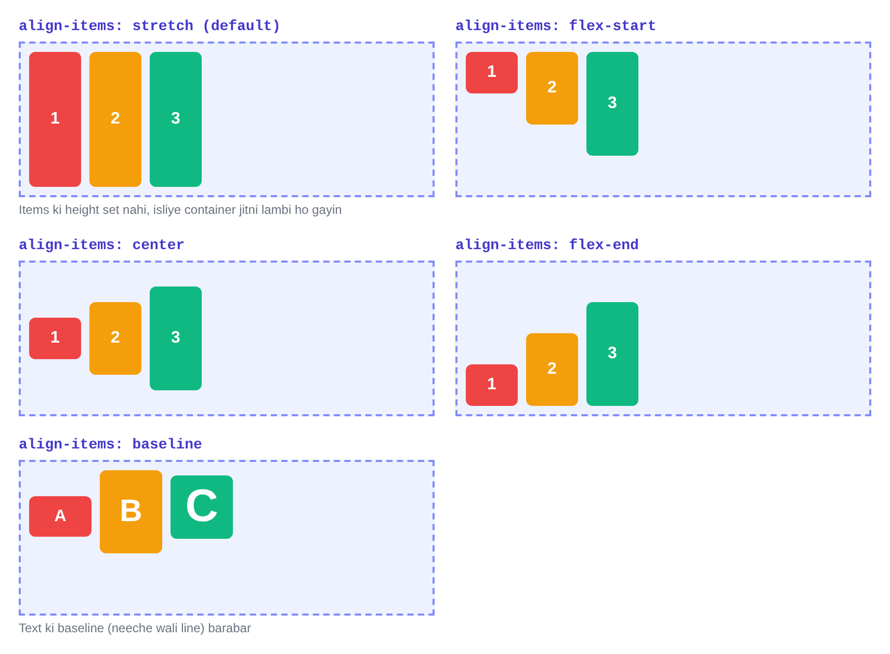

#### Values

| Value | Items kahan jate hain |
|-------|------------------------|
| `stretch` (default) | Container ki poori height tak **phail jate hain** (agar item ki height set nahi) |
| `flex-start` | Cross axis ke **shuru** mein (upar) |
| `flex-end` | Cross axis ke **aakhir** mein (neeche) |
| `center` | Cross axis ke **beech** mein |
| `baseline` | Items ke **text ki baseline** barabar hoti hai |

#### Syntax
```css
.container {
  display: flex;
  align-items: stretch | flex-start | flex-end | center | baseline;
}
```

#### Example 1: Icon Aur Text Ko Vertically Center Karna

```html
<div class="alert">
  
  <span>Aap ka message bhej diya gaya hai.</span>
</div>
```

```css
.alert {
  display: flex;
  align-items: center;   /* Icon aur text vertically barabar */
  gap: 10px;
}
```

**Output:** Chhota icon aur text ek hi line mein, vertical center par.

#### Example 2: Equal Height Cards (Stretch)

```css
.cards {
  display: flex;
  gap: 16px;
  /* align-items: stretch  default hai */
}
```

**Output:** Cards mein content kam ho ya zyada, tamam cards ki height **barabar** hoti hai.

#### Example 3: Header Mein Alag Alag Size Ke Elements

```css
.header {
  display: flex;
  justify-content: space-between;
  align-items: center;     /* Bara logo aur chhota button beech se align */
}
```

**Output:** Alag height ke elements bhi ek line mein vertical beech mein.

---

### 6.4 `flex-wrap`

#### Definition
`flex-wrap` tay karti hai ke jagah kam hone par items **ek hi line mein rahenge** ya **agli line mein chale jayenge**.

#### Real-Life Analogy
Class ki **line** mein jab jagah khatam ho jaye to students ya to **tang ho kar ek hi line mein khari rahen** (`nowrap`), ya **agli line** shuru kar lein (`wrap`).

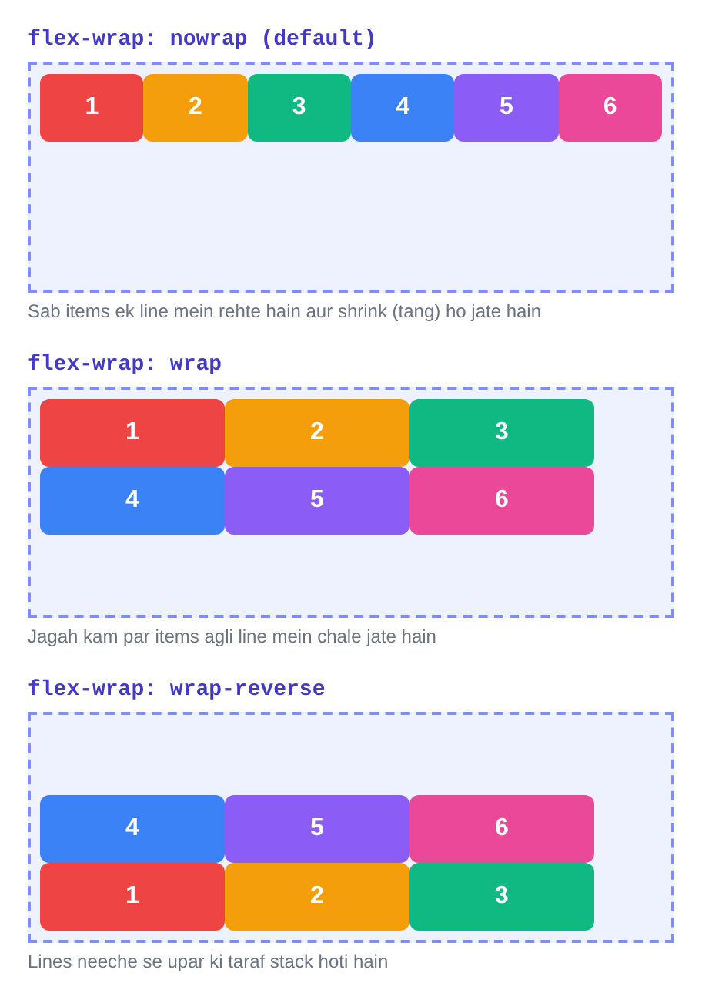

#### Values

| Value | Behavior |
|-------|----------|
| `nowrap` (default) | Sab items **ek hi line** mein, jagah kam ho to **shrink** hote hain |
| `wrap` | Jagah kam par items **agli line** mein chale jate hain |
| `wrap-reverse` | Wrap hota hai lekin lines **neeche se upar** ki taraf banti hain |

#### Syntax
```css
.container {
  display: flex;
  flex-wrap: nowrap | wrap | wrap-reverse;
}
```

#### Example 1: Tags (Chips) Ki List

```html
<div class="tags">
  <span>HTML</span><span>CSS</span><span>JavaScript</span>
  <span>Python</span><span>React</span><span>Git</span>
</div>
```

```css
.tags {
  display: flex;
  flex-wrap: wrap;     /* Jagah khatam to agli line */
  gap: 8px;
}
.tags span {
  padding: 4px 12px;
  background: #e0e7ff;
  border-radius: 20px;
}
```

**Output:** Tags ek line mein, aur jagah khatam hone par khud agli line par.

#### Example 2: Photo Gallery

```css
.gallery {
  display: flex;
  flex-wrap: wrap;
  gap: 10px;
}
.gallery img {
  width: 200px;
}
```

**Output:** Screen ki width ke mutabiq har row mein jitni images aa sakti hain, aati hain.

#### Example 3: Wrap Ke Baghair Masla

```css
.row { display: flex; }          /* nowrap */
.row .box { width: 300px; }      /* 5 boxes = 1500px */
```

**Output:** Choti screen par 5 boxes tang (shrink) ho jate hain ya screen se bahar nikal sakte hain. `flex-wrap: wrap` laga kar is masle ka hal hota hai.

---

### 6.5 `flex-flow` (Shorthand)

`flex-direction` aur `flex-wrap` ko **ek hi line** mein likhne ka shortcut.

```css
.container {
  flex-flow: row wrap;
  /* Yeh is ke barabar hai: */
  /* flex-direction: row; flex-wrap: wrap; */
}
```

---

### 6.6 `align-content`

#### Definition
`align-content` **multi-line** (jab `flex-wrap: wrap` ho aur kai lines ban jayen) container mein **lines ko Cross Axis par** align karti hai.

#### Real-Life Analogy
Bohat si **lines (rows)** hain jin mein students khari hain. `align-items` ek line ke **andar** students ko align karta hai. `align-content` **poori lines** ko class (container) ke upar-neeche kahan rakhna hai yeh tay karta hai.

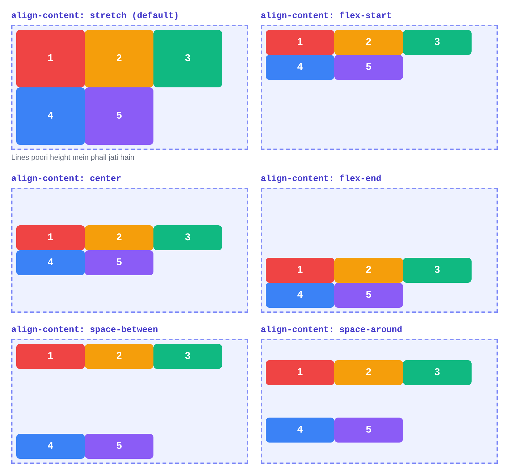

#### Values

| Value | Lines kahan jati hain |
|-------|------------------------|
| `stretch` (default) | Lines poori height mein **phail** jati hain |
| `flex-start` | Sab lines **upar** |
| `flex-end` | Sab lines **neeche** |
| `center` | Sab lines **beech** mein |
| `space-between` | Pehli line upar, aakhri neeche, beech mein barabar faasla |
| `space-around` | Har line ke dono taraf barabar faasla |

#### Syntax
```css
.container {
  display: flex;
  flex-wrap: wrap;
  height: 300px;
  align-content: center;
}
```

#### align-items vs align-content

| Feature | `align-items` | `align-content` |
|---------|---------------|-----------------|
| Kis ko align karta hai | Ek line ke **items** ko | Poori **lines** ko |
| Kab kaam karta hai | Hamesha | Sirf jab **`flex-wrap: wrap`** ho aur **kai lines** hon |
| Zaroorat | Container mein extra cross-axis jagah ho to nazar aata hai | Container ki height lines se zyada ho |

> **Dhyan dein:** Agar sirf ek hi line hai ya `flex-wrap: nowrap` hai to `align-content` ka **koi asar nahi** parta.

---

### 6.7 `gap`

#### Definition
`gap` Flex Items ke **darmiyan faasla** deti hai. Pehle isi kaam ke liye margin use hote the aur kinaron par extra margin ka masla hota tha.

#### Real-Life Analogy
Do kursiyon ke beech **chhor hui jagah**. Yeh sirf **kursiyon ke darmiyan** hoti hai, deewar aur pehli kursi ke beech nahi.

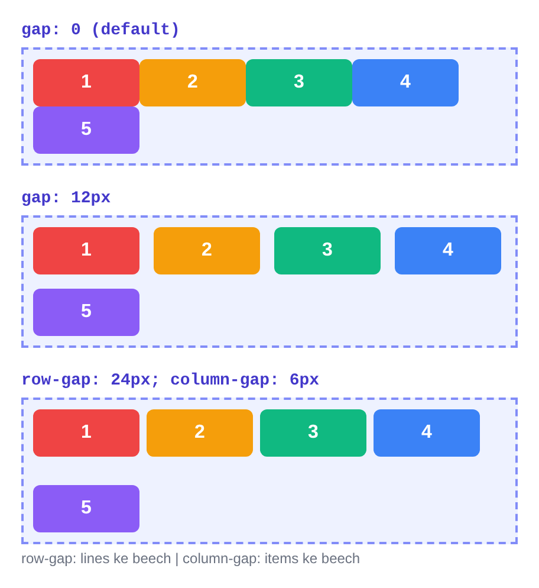

#### Syntax
```css
.container {
  display: flex;
  flex-wrap: wrap;

  gap: 20px;                        /* row aur column dono ke liye */
  gap: 24px 6px;                    /* row-gap  column-gap */

  row-gap: 24px;                    /* lines ke darmiyan */
  column-gap: 6px;                  /* items ke darmiyan (same line mein) */
}
```

#### Example: Cards Ke Darmiyan Faasla

```css
.cards {
  display: flex;
  gap: 20px;       /* Cards ke beech 20px, kinaron par koi extra faasla nahi */
}
```

> **Tip:** Items ke beech faasle ke liye `margin` ki jagah `gap` use karein. Code saaf rehta hai.

---

### 6.8 Sab Se Zaroori: Axis Swap (Direction Badalne Par Kya Hota Hai)

`flex-direction: column` karne par **Main Axis aur Cross Axis ek dusre ki jagah le lete hain**. Is ki wajah se `justify-content` aur `align-items` ka kaam **ulat** jata hai.

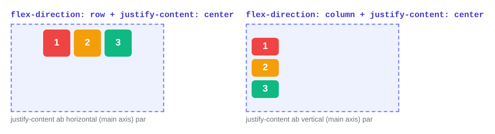

| `flex-direction` | Main Axis | `justify-content` kya karta hai | `align-items` kya karta hai |
|------------------|-----------|----------------------------------|------------------------------|
| `row` | Horizontal (left-right) | **Horizontal** alignment | **Vertical** alignment |
| `column` | Vertical (upar-neeche) | **Vertical** alignment | **Horizontal** alignment |

> **Yaad rakhne ka tareeqa:** Properties ke naam kabhi nahi badalte. Sirf **axis** badalta hai.
> - `justify-content` = hamesha **Main Axis**
> - `align-items` = hamesha **Cross Axis**

---

### 6.9 Perfect Centering (Sab Se Mashhoor Use)

Kisi element ko **horizontal aur vertical dono** taraf bilkul beech mein rakhna.

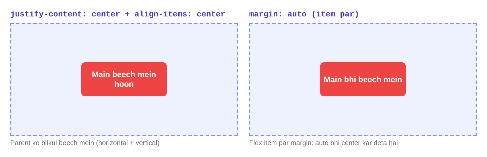

```html
<div class="parent">
  <div class="child">Main beech mein hoon</div>
</div>
```

```css
.parent {
  display: flex;
  justify-content: center;   /* horizontal center */
  align-items: center;       /* vertical center */
  height: 300px;
}
```

**Doosra tareeqa (item par `margin: auto`):**

```css
.parent { display: flex; height: 300px; }
.child  { margin: auto; }    /* Dono taraf ki khali jagah barabar le leta hai */
```

> Pichli README mein `position: absolute` + `transform: translate(-50%, -50%)` wala tareeqa tha. Flexbox ke sath yeh kaam bohat aasan hai. Lekin overlay aur popup mein `absolute` wala tareeqa abhi bhi use hota hai.

---

## 7. Flex Item Properties

Yeh properties **children (Flex Items)** par likhi jati hain.

| Property | Kaam |
|----------|------|
| `order` | Item ki **visual tarteeb** badalna |
| `flex-grow` | Khali jagah mein item **kitna barhe** |
| `flex-shrink` | Jagah kam par item **kitna sikure** |
| `flex-basis` | Item ka **shuruati size** |
| `flex` | `grow`, `shrink`, `basis` ka **shorthand** |
| `align-self` | **Sirf ek item** ki alag cross-axis alignment |

---

### 7.1 `order`

#### Definition
`order` HTML badle baghair items ki **visual tarteeb** badal deti hai. **Chhota number pehle** aata hai. Default `0` hai.

#### Real-Life Analogy
Class mein **roll number** ke mutabiq line banti hai. Chahe students kisi bhi tarteeb mein aayen, line roll number ke hisab se hi banegi.

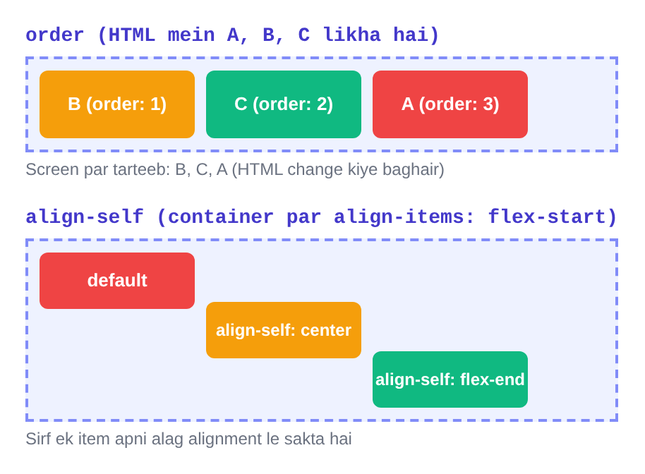

*(Upar wali panel `order` dikhata hai. Neeche wali panel `align-self` dikhata hai, jo Section 7.6 mein hai.)*

#### Syntax
```css
.item {
  order: 0;     /* default */
}
```

#### Example 1: Mobile Par Sidebar Ko Neeche Bhejna

```css
@media (max-width: 768px) {
  main  { order: 1; }    /* pehle */
  aside { order: 2; }    /* baad mein */
}
```

**Output:** HTML mein `aside` pehle likha ho tab bhi mobile par `main` pehle nazar aata hai.

#### Example 2: Ek Item Ko Sab Se Pehle Laana

```css
.featured { order: -1; }   /* Negative number sab se pehle */
```

---

### 7.2 `flex-grow`

#### Definition
`flex-grow` batata hai ke container mein **bachi hui khali jagah** mein item **kitna hissa** lega. Default `0` hai (yaani item barhta nahi).

#### Real-Life Analogy
Teen bhai ek **bari mithai (khali jagah)** barabar ya hisse ke hisab se taqseem karte hain:
- Sab ka `flex-grow: 1` = **barabar hissa**
- Ek bhai ka `flex-grow: 2` = us ko **doosron se double hissa**

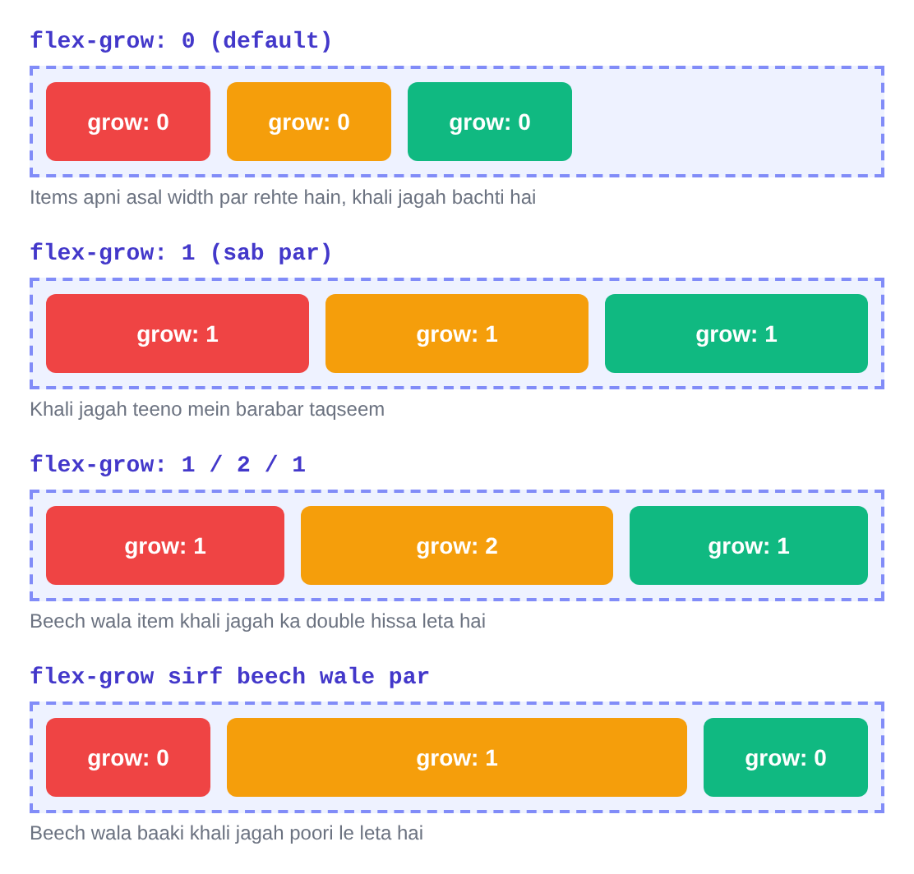

#### Formula (Aasan)

```
Khali jagah = Container ki width - (items ki total width + gaps)

Har item ka extra hissa = Khali jagah x (us item ka grow / sab grow ka jama)
```

**Misaal (upar ki image):** Container ke andar 500px jagah, 3 items 100px wale aur 2 gaps 10px wale.
- Khali jagah = 500 - (300 + 20) = **180px**
- `grow: 1 / 2 / 1` ka jama = 4
- Pehla item: 100 + (180 x 1/4) = **145px**
- Beech wala: 100 + (180 x 2/4) = **190px**
- Teesra: 100 + (180 x 1/4) = **145px**

#### Syntax
```css
.item {
  flex-grow: 1;
}
```

#### Example 1: Search Bar (Input Baaki Saari Jagah Le)

```html
<form class="search">
  <input type="text" placeholder="Search...">
  <button>Go</button>
</form>
```

```css
.search { display: flex; gap: 8px; }
.search input  { flex-grow: 1; }    /* Button ke baad jitni jagah bachi woh input le */
```

**Output:** Button chhota rehta hai aur input baaki saari width le leta hai.

#### Example 2: Main Content Aur Sidebar

```css
.layout { display: flex; gap: 20px; }
aside   { width: 220px; }
main    { flex-grow: 1; }     /* Sidebar ke baad baaki saari width */
```

---

### 7.3 `flex-shrink`

#### Definition
`flex-shrink` batata hai ke jab **jagah kam** ho to item **kitna sikure (chhota ho)**. Default `1` hai (yaani sab barabar shrink hote hain). `0` ka matlab item **bilkul shrink nahi hoga**.

#### Real-Life Analogy
Bus mein **zyada log** aa gaye. Sab thora thora **tang ho kar** baith jate hain (`shrink: 1`). Lekin ek **bara sandook** hai jis ko chhota nahi kiya ja sakta (`shrink: 0`), us ki jagah barqarar rehti hai aur baaki log aur tang ho jate hain.

*(Image Section 7.4 ke sath hai.)*

#### Syntax
```css
.item {
  flex-shrink: 1;   /* default */
}
.logo {
  flex-shrink: 0;   /* is item ko chhota na karo */
}
```

#### Example: Image Ko Pichakne Se Bachana

```css
.profile { display: flex; gap: 12px; }
.profile img { width: 60px; flex-shrink: 0; }   /* Choti screen par bhi 60px rahegi */
```

---

### 7.4 `flex-basis`

#### Definition
`flex-basis` item ka **shuruati size (main axis par)** tay karta hai, grow ya shrink hone se **pehle**. Row mein yeh **width** jaisa kaam karta hai, column mein **height** jaisa.

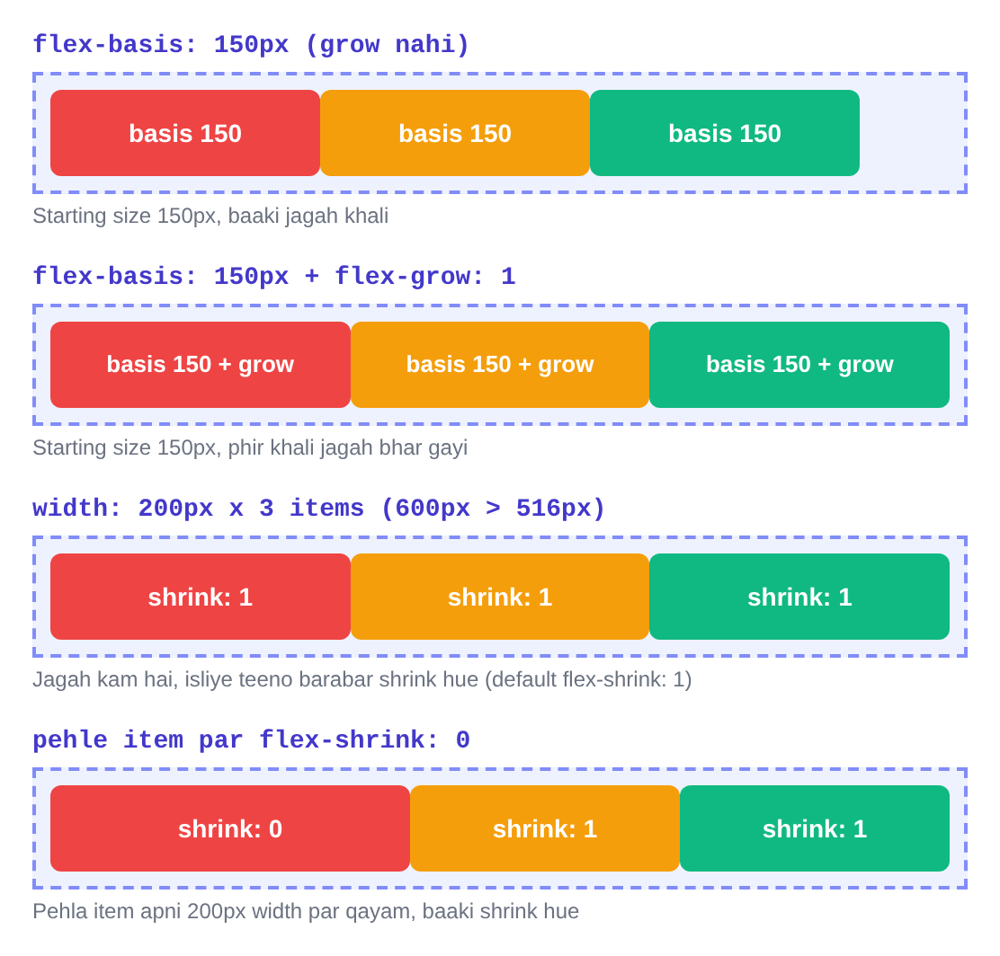

#### Syntax
```css
.item {
  flex-basis: 200px;    /* shuruati size */
  flex-basis: 30%;
  flex-basis: auto;     /* default: width/content ke mutabiq */
}
```

#### flex-basis vs width

| Feature | `width` | `flex-basis` |
|---------|---------|--------------|
| Direction | Hamesha horizontal | Main axis ke mutabiq (row mein width, column mein height) |
| Priority | Kam | `flex-basis` ko **zyada tarjeeh** milti hai (auto na ho to) |

---

### 7.5 `flex` (Shorthand)

`flex-grow`, `flex-shrink` aur `flex-basis` ko ek hi line mein likhna.

```css
.item {
  flex: 1 1 200px;
  /* flex: <grow> <shrink> <basis> */
}
```

#### Common Values

| Shorthand | Matlab (grow shrink basis) | Kab use karein |
|-----------|-----------------------------|----------------|
| `flex: 1` | `1 1 0%` | Items **barabar width** mein baant do |
| `flex: auto` | `1 1 auto` | Content ke mutabiq size, phir bachi jagah baanto |
| `flex: none` | `0 0 auto` | Item **bilkul na barhe na sikure** |
| `flex: 0 0 200px` | `0 0 200px` | **Fixed 200px** width (sidebar) |
| `flex: 1 1 250px` | `1 1 250px` | Responsive card (kam az kam 250px chahiye, jagah ho to barhe) |
| `flex: initial` | `0 1 auto` | Default behavior |

#### Example: Teen Barabar Columns

```css
.columns { display: flex; gap: 16px; }
.columns .col { flex: 1; }     /* Teeno barabar width */
```

---

### 7.6 `align-self`

#### Definition
`align-self` **sirf ek item** ko container ki `align-items` se **alag** cross-axis alignment deta hai.

#### Real-Life Analogy
Class mein sab students **upar (shuru)** khari hain, lekin teacher **sirf Ayesha** ko kehti hai ke woh **beech mein** khari ho. Baaki wahi rahengi.

*(Image Section 7.1 mein neeche wali panel hai.)*

#### Values
`auto` (default), `flex-start`, `flex-end`, `center`, `stretch`, `baseline`

#### Syntax
```css
.container { display: flex; align-items: flex-start; }
.special   { align-self: center; }   /* Sirf yeh item beech mein */
```

#### Example: Card Mein Button Ko Neeche Rakhna

```css
.card { display: flex; flex-direction: column; }
.card .button { align-self: flex-end; }    /* Button right (cross axis end) par */
```

---

### 7.7 `margin: auto` Flex Items Mein

Flex Item par `margin: auto` **khali jagah ko absorb** kar leta hai. Is se item ko ek kinare par **dhakel** diya ja sakta hai.

#### Example: Logo Left, Login Button Sab Se Right

```html
<nav class="navbar">
  <div class="logo">MySchool</div>
  <a href="#">Home</a>
  <a href="#">About</a>
  <a href="#" class="login">Login</a>
</nav>
```

```css
.navbar { display: flex; gap: 16px; }
.navbar .login { margin-left: auto; }   /* Login ko sab se right par dhakel do */
```

**Output:** Logo, Home, About left mein aur Login right kinare par.

---

## 8. Media Queries

### 8.1 Media Query Kya Hai?

#### Definition
**Media Query** CSS ka ek feature hai jo **screen ki condition** (width, height, orientation waghera) check karta hai. Condition **sach (true)** ho to us ke andar likhi hui CSS apply hoti hai, warna nahi.

#### Real-Life Analogy
Aap **mausam ke hisab se kapre** pehente hain:
- *Agar* garmi hai (condition true) = halke kapre
- *Agar* sardi hai = garam kapre

Isi tarah website bhi **screen ke size ke hisab se** apni shakal badalti hai:
- *Agar* screen **choti** hai = menu ek ke neeche ek
- *Agar* screen **bari** hai = menu ek row mein

### 8.2 Media Queries Kyun Use Hoti Hain?

- Website **mobile, tablet, laptop, desktop** sab par sahi nazar aaye (**Responsive Design**)
- Aaj kal **zyada tar users mobile** se website dekhte hain
- Ek hi HTML file se alag alag devices ke liye alag layout
- Dark mode, print layout jaisi cheezein bhi in se hoti hain

### 8.3 Media Query Kaise Likhte Hain? (Syntax)

```css
@media media-type and (media-feature) {
  /* Yahan CSS likhein */
}
```

```css
/* Screen ki width 768px ya us se kam ho to */
@media (max-width: 768px) {
  .navbar {
    flex-direction: column;
  }
}
```

| Hissa | Matlab |
|-------|--------|
| `@media` | Media query shuru karne ka keyword |
| `(max-width: 768px)` | Condition (feature aur value) |
| `{ ... }` | Condition sach hone par lagne wali CSS |

### 8.4 Viewport Meta Tag (Bohat Zaroori)

Media queries mobile par **tab tak sahi kaam nahi karti** jab tak HTML ke `<head>` mein yeh tag na ho:

```html
<meta name="viewport" content="width=device-width, initial-scale=1.0">
```

Is ke baghair mobile browser page ko **desktop jitni width (taqreeban 980px)** samajh kar chhota kar ke dikhata hai, aur aap ki media queries mobile par fire hi nahi hoti.

### 8.5 Media Features (Kin Cheezon Ko Check Kar Sakte Hain)

| Feature | Matlab | Misaal |
|---------|--------|--------|
| `min-width` | Width **is se zyada ya barabar** | `(min-width: 768px)` |
| `max-width` | Width **is se kam ya barabar** | `(max-width: 767px)` |
| `width` | Bilkul isi width par | `(width: 1024px)` |
| `min-height` / `max-height` | Screen ki height | `(min-height: 600px)` |
| `orientation` | Portrait ya landscape | `(orientation: landscape)` |
| `prefers-color-scheme` | User ka dark ya light mode | `(prefers-color-scheme: dark)` |
| `prefers-reduced-motion` | User ne animation kam karne ko kaha ho | `(prefers-reduced-motion: reduce)` |
| `hover` | Device mein hover (mouse) ho ya nahi | `(hover: hover)` |

### 8.6 Media Types

| Type | Matlab |
|------|--------|
| `all` | Tamam devices (default) |
| `screen` | Computer, phone, tablet ki screen |
| `print` | Jab page print kiya jaye |

```css
@media print {
  nav, footer { display: none; }   /* Print karte waqt navbar aur footer chhupa do */
}
```

### 8.7 Logical Operators (Conditions Ko Jodna)

| Operator | Matlab | Misaal |
|----------|--------|--------|
| `and` | **Dono** conditions sach hon | `(min-width: 600px) and (max-width: 900px)` |
| `,` (comma) | **Koi ek** condition sach ho (OR) | `(max-width: 480px), (orientation: portrait)` |
| `not` | Condition **ulti** | `not print` |

```css
/* 600px se 900px ke darmiyan (tablet) */
@media (min-width: 600px) and (max-width: 900px) {
  .card { flex-basis: 50%; }
}
```

**Naya (Range) Syntax:** Naye browsers mein comparison operators bhi chalte hain:

```css
@media (width >= 768px) { ... }          /* min-width: 768px ke barabar */
@media (600px <= width <= 900px) { ... } /* dono hadon ke darmiyan */
```

### 8.8 Breakpoints Kya Hote Hain?

#### Definition
**Breakpoint** screen ki wo **width** hai jis par aap ka layout **badalta (break hota)** hai. Is jagah par media query lagti hai.

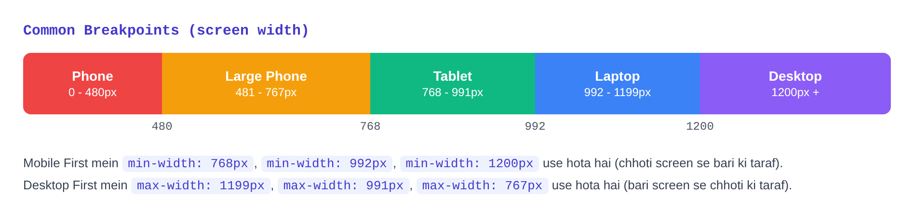

#### Aam Breakpoints

| Device | Width | Media Query (Mobile First) |
|--------|-------|-----------------------------|
| Phone (chhota) | 0 se 480px | Default CSS (koi query nahi) |
| Large Phone | 481px se 767px | `@media (min-width: 481px)` |
| Tablet | 768px se 991px | `@media (min-width: 768px)` |
| Laptop | 992px se 1199px | `@media (min-width: 992px)` |
| Desktop | 1200px ya zyada | `@media (min-width: 1200px)` |

> Is guide ke projects mein 480px, 600px, 768px aur 992px use hue hain. Breakpoints **ki koi ek fixed list nahi** hoti.

#### Mashhoor Frameworks Ke Breakpoints (Reference Ke Liye)

| Framework | Breakpoints |
|-----------|-------------|
| **Bootstrap 5** | 576px, 768px, 992px, 1200px, 1400px |
| **Tailwind CSS** | 640px, 768px, 1024px, 1280px, 1536px |

#### Breakpoint Kaise Chunein? (Professional Tip)

> Breakpoints **devices ke naam** (iPhone, iPad) ke hisab se nahi, balke **content ke hisab se** chunein. Browser ki width dheere dheere kam karein. Jis jagah layout kharab hone lage, **wahi aap ka breakpoint** hai.

### 8.9 Mobile First vs Desktop First

| Feature | Mobile First | Desktop First |
|---------|--------------|----------------|
| Shuruati CSS | **Chhoti screen** ke liye | **Bari screen** ke liye |
| Media query | `min-width` | `max-width` |
| Direction | Chhoti se bari screen ki taraf | Bari se chhoti screen ki taraf |
| Recommended? | **Haan** (modern tareeqa) | Purane projects mein |

**Mobile First (Recommended):**

```css
/* Default: mobile (1 column) */
.card { flex: 0 0 100%; }

/* 600px ya us se bari screen: 2 columns */
@media (min-width: 600px) {
  .card { flex-basis: calc(50% - 10px); }
}

/* 992px ya us se bari screen: 4 columns */
@media (min-width: 992px) {
  .card { flex-basis: calc(25% - 15px); }
}
```

**Desktop First:**

```css
/* Default: desktop (4 columns) */
.card { flex: 0 0 calc(25% - 15px); }

/* 991px ya us se chhoti: 2 columns */
@media (max-width: 991px) {
  .card { flex-basis: calc(50% - 10px); }
}

/* 599px ya us se chhoti: 1 column */
@media (max-width: 599px) {
  .card { flex-basis: 100%; }
}
```

> **Mobile First kyun behtar hai?** Mobile devices ko sirf zaroori CSS milti hai, aur code zyada saaf rehta hai.

### 8.10 Flexbox Aur Media Queries Ek Sath

Responsive layout ke liye yeh dono sab se zyada ek sath use hote hain. Neeche 5 aam patterns hain.

**Pattern 1: Row Se Column**

```css
.navbar { display: flex; justify-content: space-between; }

@media (max-width: 768px) {
  .navbar { flex-direction: column; gap: 12px; }
}
```

**Pattern 2: Columns Ki Ginti Badalna (Cards Grid)**

```css
.cards { display: flex; flex-wrap: wrap; gap: 20px; }
.card  { flex: 0 0 100%; }                                   /* mobile: 1 column */

@media (min-width: 600px) { .card { flex-basis: calc(50% - 10px); } }  /* tablet: 2 */
@media (min-width: 992px) { .card { flex-basis: calc(25% - 15px); } }  /* desktop: 4 */
```

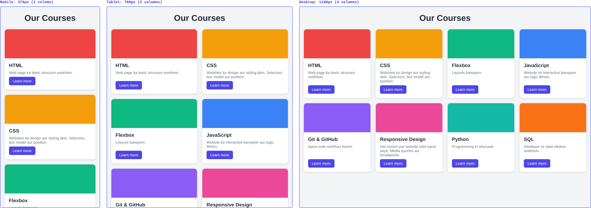

*(Yeh teeno alag alag screen width par same HTML hai. Sirf media queries ki wajah se columns badal rahe hain.)*

**Pattern 3: Sidebar Ko Neeche Bhejna**

```css
.layout { display: flex; gap: 20px; }

@media (max-width: 768px) {
  .layout  { flex-direction: column; }
  .sidebar { order: 2; }
}
```

**Pattern 4: Mobile Par Kuch Elements Chhupana**

```css
@media (max-width: 480px) {
  .ad-banner { display: none; }
}
```

**Pattern 5: Spacing Aur Font Size Badalna**

```css
.hero h1 { font-size: 2.5rem; }

@media (max-width: 768px) {
  .hero h1 { font-size: 1.6rem; }
  .hero    { padding: 20px; }
}
```

### 8.11 Responsive Layout Test Kaise Karein?

1. Browser mein page kholein.
2. **F12** dabayen (Developer Tools).
3. **Device Toolbar** on karein (Chrome ya Edge mein `Ctrl + Shift + M`).
4. Upar se **device** chunein (iPhone, iPad) ya width khud drag karke kam zyada karein.
5. Dekhein ke layout kis width par kharab hota hai. Wahi aap ka breakpoint hai.

### 8.12 Media Queries Ki Aam Ghaltiyan

| Ghalti | Wajah | Hal |
|--------|-------|-----|
| Mobile par media query kaam nahi kar rahi | Viewport meta tag nahi hai | `<meta name="viewport" ...>` lagayen |
| Query ka koi asar nahi | Media query CSS mein **upar** likhi hai aur baad ki CSS usay override kar rahi hai | Media query hamesha **normal CSS ke baad** likhein |
| `min-width` aur `max-width` mix kar diye | Dono ek hi 768px par overlap karte hain | Ek hi approach (mobile first ya desktop first) par qayam rahein |
| Bohat zyada breakpoints | Code ulajh jata hai | 3 se 4 breakpoints kaafi hote hain |
| Fixed `width: 500px` | Choti screen par horizontal scroll | `max-width` aur percentage use karein |

---

## 9. Common Layout Patterns

### Pattern 1: Perfect Center

```css
.center {
  display: flex;
  justify-content: center;
  align-items: center;
  min-height: 100vh;
}
```

### Pattern 2: Navbar (Logo Left, Links Right)

```css
.navbar { display: flex; align-items: center; }
.navbar .logo  { margin-right: auto; }     /* baaki sab ko right par dhakel do */
.navbar .links { display: flex; gap: 20px; }
```

### Pattern 3: Equal Height Cards (Button Hamesha Neeche)

```css
.cards { display: flex; gap: 20px; }
.card  { display: flex; flex-direction: column; flex: 1; }
.card .btn { margin-top: auto; }   /* Button hamesha card ke neeche */
```

### Pattern 4: Sticky Footer (Footer Hamesha Neeche)

```css
body    { min-height: 100vh; display: flex; flex-direction: column; }
main    { flex: 1; }          /* Baaki saari height le lo */
footer  { /* khud neeche chala jata hai */ }
```

### Pattern 5: Media Object (Image Aur Text)

```css
.media { display: flex; gap: 14px; align-items: flex-start; }
.media img { width: 64px; flex-shrink: 0; }
.media .text { flex: 1; }
```

### Pattern 6: Input Aur Button Ek Line Mein

```css
.search { display: flex; }
.search input  { flex: 1; }
.search button { flex-shrink: 0; }
```

---

## 10. Common Mistakes

| Ghalti | Wajah | Hal |
|--------|-------|-----|
| Grandchildren par flexbox ka asar nahi | `display: flex` sirf **direct children** ko flex item banata hai | Us child par bhi `display: flex` lagayen (nested flex) |
| `justify-content` se vertical alignment nahi ho rahi | Direction `row` hai, `justify-content` horizontal par kaam karta hai | Vertical ke liye `align-items` use karein, ya `flex-direction: column` mein `justify-content` |
| `align-items: center` ka asar nahi | Container ki height set nahi hai (content jitni hai) | Container ko `height` ya `min-height` dein |
| `align-content` ka asar nahi | `flex-wrap: wrap` nahi hai ya sirf ek line hai | `flex-wrap: wrap` lagayen |
| Items zabardasti tang ho gaye | `flex-shrink: 1` default hai | Us item par `flex-shrink: 0` ya `min-width` dein |
| Lamba text container se bahar nikal gaya | Flex item ki `min-width` default `auto` hoti hai | Item par `min-width: 0` lagayen |
| Items ke beech faasla nahi | `gap` nahi diya | `gap: 16px` lagayen |
| Mobile par layout nahi badla | Viewport meta tag ya media query ki jagah ghalat | Section 8.4 aur 8.12 dekhein |
| Image flex item mein stretch ho gayi | `align-items: stretch` default hai | Image par `align-self: flex-start` ya `align-items: flex-start` |

---

## 11. Quick Cheat Sheet

### Container Par

| Property | Common Values |
|----------|---------------|
| `display` | `flex`, `inline-flex` |
| `flex-direction` | `row`, `row-reverse`, `column`, `column-reverse` |
| `flex-wrap` | `nowrap`, `wrap`, `wrap-reverse` |
| `flex-flow` | `row wrap` |
| `justify-content` | `flex-start`, `flex-end`, `center`, `space-between`, `space-around`, `space-evenly` |
| `align-items` | `stretch`, `flex-start`, `flex-end`, `center`, `baseline` |
| `align-content` | `stretch`, `flex-start`, `flex-end`, `center`, `space-between`, `space-around` |
| `gap` | `10px`, `10px 20px` |

### Items Par

| Property | Common Values |
|----------|---------------|
| `order` | `-1`, `0`, `1`, `2` |
| `flex-grow` | `0`, `1`, `2` |
| `flex-shrink` | `0`, `1` |
| `flex-basis` | `auto`, `200px`, `30%` |
| `flex` | `1`, `auto`, `none`, `0 0 200px` |
| `align-self` | `auto`, `flex-start`, `flex-end`, `center`, `stretch` |

### Yaad Rakhne Ka Aasan Tareeqa

- `justify-content` = **Main Axis** par
- `align-items` = **Cross Axis** par
- `flex-wrap: wrap` = **agli line** ki ijazat
- `flex: 1` = **barabar hissa**
- `gap` = items ke **beech** faasla
- `margin-left: auto` = item ko **right par dhakel** do
- `min-width` media query = **Mobile First**
- `max-width` media query = **Desktop First**

---

## 12. Mini Projects

Har project ka **poora code** `projects/` folder mein alag file mein hai. File ko browser mein khol kar chala sakte hain. Browser ki width kam zyada kar ke responsive behavior dekhein.

### Project 1: Centered Login Card (Beginner)

**Seekhne wali cheezein:** `display: flex`, `justify-content`, `align-items` (perfect centering), `flex-direction: column`, `gap`, `space-between`, mobile media query.

**File:** `projects/01-login-card.html`

| Desktop | Mobile |
|---------|--------|
| 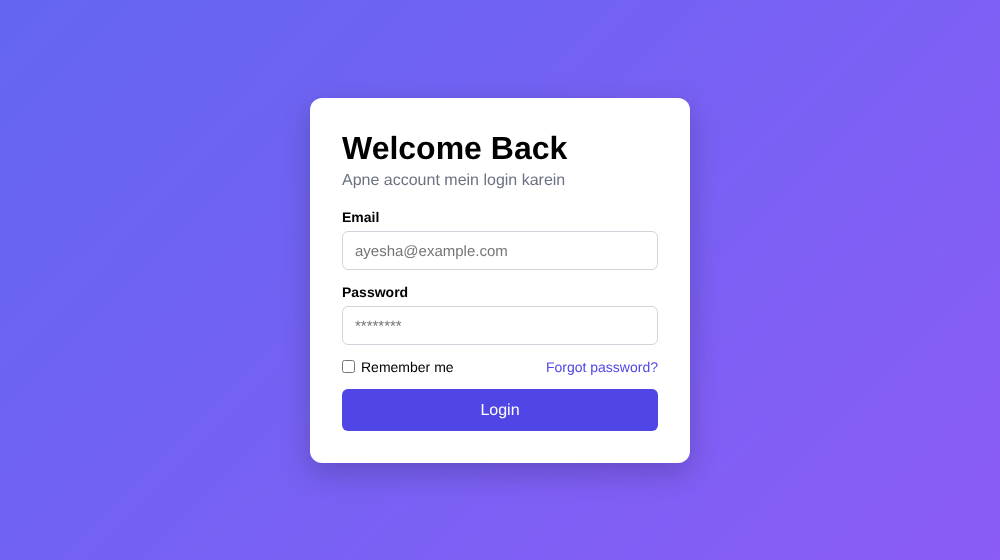 | 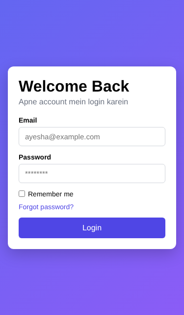 |

```html
<!DOCTYPE html>
<html lang="en">
<head>
  <meta charset="UTF-8">
  <meta name="viewport" content="width=device-width, initial-scale=1.0">
  <title>Project 1: Centered Login Card</title>
  <style>
    * { box-sizing: border-box; margin: 0; padding: 0; }

    body {
      font-family: Arial, sans-serif;
      min-height: 100vh;                 /* poori screen ki height */
      display: flex;                     /* Flex Container */
      justify-content: center;           /* horizontal center (main axis) */
      align-items: center;               /* vertical center (cross axis) */
      padding: 16px;
      background: linear-gradient(135deg, #6366f1, #8b5cf6);
    }

    .card {
      width: 100%;
      max-width: 380px;
      padding: 32px;
      background: #fff;
      border-radius: 12px;
      box-shadow: 0 10px 30px rgba(0, 0, 0, 0.2);
    }

    .card h1 { margin-bottom: 4px; }
    .card p.sub { color: #6b7280; margin-bottom: 20px; }

    form {
      display: flex;
      flex-direction: column;            /* fields ek ke neeche ek */
      gap: 14px;                         /* fields ke darmiyan faasla */
    }

    label {
      display: flex;
      flex-direction: column;            /* label upar, input neeche */
      gap: 6px;
      font-size: 14px;
      font-weight: bold;
    }

    input[type="email"], input[type="password"] {
      padding: 10px 12px;
      border: 1px solid #d1d5db;
      border-radius: 6px;
      font-size: 15px;
    }

    .options {
      display: flex;
      justify-content: space-between;    /* ek left, doosra right */
      align-items: center;
      font-size: 14px;
    }
    .options a { color: #4f46e5; text-decoration: none; }

    .remember {
      display: flex;
      align-items: center;               /* checkbox aur text barabar */
      gap: 6px;
      font-weight: normal;
      flex-direction: row;
    }

    button {
      padding: 12px;
      border: none;
      border-radius: 6px;
      background: #4f46e5;
      color: #fff;
      font-size: 16px;
      cursor: pointer;
    }
    button:hover { background: #4338ca; }

    /* Chhoti screen (mobile) */
    @media (max-width: 480px) {
      .card { padding: 22px; }
      .options { flex-direction: column; align-items: flex-start; gap: 10px; }
    }
  </style>
</head>
<body>

  <div class="card">
    <h1>Welcome Back</h1>
    <p class="sub">Apne account mein login karein</p>

    <form>
      <label>
        Email
        <input type="email" placeholder="ayesha@example.com">
      </label>

      <label>
        Password
        <input type="password" placeholder="********">
      </label>

      <div class="options">
        <label class="remember"><input type="checkbox"> Remember me</label>
        <a href="#">Forgot password?</a>
      </div>

      <button type="submit">Login</button>
    </form>
  </div>

</body>
</html>
```

**Challenge:** Login card mein "Create Account" ka button add karein jo `margin-top: auto` ya `align-self` ke sath neeche aaye.

---

### Project 2: Responsive Navbar (Beginner to Intermediate)

**Seekhne wali cheezein:** `space-between`, `align-items: center`, `gap`, `flex-wrap`, media query (`max-width: 768px`), `flex-direction: column`.

**File:** `projects/02-responsive-navbar.html`

**Desktop:** Logo left, menu beech mein, button right (ek row).

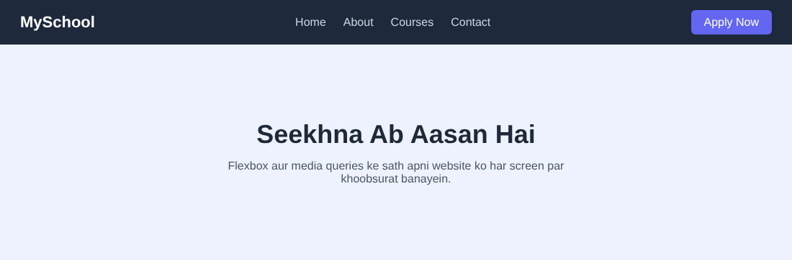

**Mobile:** Sab ek ke neeche, menu `flex-wrap` ke sath.


```html
<!DOCTYPE html>
<html lang="en">
<head>
  <meta charset="UTF-8">
  <meta name="viewport" content="width=device-width, initial-scale=1.0">
  <title>Project 2: Responsive Navbar</title>
  <style>
    * { box-sizing: border-box; margin: 0; padding: 0; }

    body { font-family: Arial, sans-serif; color: #1f2937; }

    /* ---------- Navbar (Desktop First: row layout) ---------- */
    .navbar {
      display: flex;
      justify-content: space-between;    /* logo left, menu right */
      align-items: center;
      padding: 14px 28px;
      background: #1e293b;
      color: #fff;
    }

    .logo { font-size: 22px; font-weight: bold; }

    .menu {
      display: flex;
      gap: 24px;
      list-style: none;
    }
    .menu a {
      color: #cbd5e1;
      text-decoration: none;
    }
    .menu a:hover { color: #fff; }

    .btn {
      padding: 8px 18px;
      border-radius: 6px;
      background: #6366f1;
      color: #fff;
      text-decoration: none;
    }

    /* ---------- Hero ---------- */
    .hero {
      display: flex;
      flex-direction: column;
      align-items: center;
      justify-content: center;
      gap: 14px;
      min-height: 300px;
      padding: 24px;
      text-align: center;
      background: #eef2ff;
    }
    .hero h1 { font-size: 36px; }
    .hero p  { max-width: 520px; color: #4b5563; }

    /* ---------- Tablet aur chhoti screen: 768px ya us se kam ---------- */
    @media (max-width: 768px) {
      .navbar {
        flex-direction: column;          /* logo upar, menu neeche */
        gap: 12px;
      }
      .menu {
        flex-wrap: wrap;                 /* jagah kam ho to agli line */
        justify-content: center;
        gap: 14px 20px;
      }
      .hero h1 { font-size: 26px; }
    }
  </style>
</head>
<body>

  <header class="navbar">
    <div class="logo">MySchool</div>

    <ul class="menu">
      <li><a href="#">Home</a></li>
      <li><a href="#">About</a></li>
      <li><a href="#">Courses</a></li>
      <li><a href="#">Contact</a></li>
    </ul>

    <a href="#" class="btn">Apply Now</a>
  </header>

  <section class="hero">
    <h1>Seekhna Ab Aasan Hai</h1>
    <p>Flexbox aur media queries ke sath apni website ko har screen par khoobsurat banayein.</p>
  </section>

</body>
</html>
```

**Challenge:** Mobile par menu ko ek "hamburger" button ke peeche chhupayen (`display: none` aur button ke click par `display: flex`).

---

### Project 3: Responsive Card Grid (Intermediate)

**Seekhne wali cheezein:** `flex-wrap`, `flex-basis`, `calc()`, `gap`, nested flexbox (card ke andar flex column), `margin-top: auto`, **teen breakpoints** (mobile first).

**File:** `projects/03-responsive-cards.html`


| Screen | Columns | Media Query |
|--------|---------|-------------|
| Mobile (default) | 1 | koi query nahi |
| 600px se bari | 2 | `@media (min-width: 600px)` |
| 992px se bari | 4 | `@media (min-width: 992px)` |

```html
<!DOCTYPE html>
<html lang="en">
<head>
  <meta charset="UTF-8">
  <meta name="viewport" content="width=device-width, initial-scale=1.0">
  <title>Project 3: Responsive Card Grid</title>
  <style>
    * { box-sizing: border-box; margin: 0; padding: 0; }

    body {
      font-family: Arial, sans-serif;
      padding: 24px 16px;
      background: #f3f4f6;
      color: #1f2937;
    }

    h1 { text-align: center; margin-bottom: 24px; }

    /* ---------- Flex Container ---------- */
    .cards {
      display: flex;
      flex-wrap: wrap;                   /* jagah kam par agli line */
      gap: 20px;
      max-width: 1200px;
      margin: 0 auto;
    }

    /* ---------- Mobile First: 1 column (default) ---------- */
    .card {
      flex: 0 0 100%;                    /* grow 0, shrink 0, basis 100% */
      display: flex;
      flex-direction: column;            /* card ke andar bhi flexbox */
      background: #fff;
      border-radius: 10px;
      overflow: hidden;
      box-shadow: 0 2px 8px rgba(0, 0, 0, 0.1);
    }

    .thumb { height: 110px; }
    .c1 { background: #ef4444; } .c2 { background: #f59e0b; }
    .c3 { background: #10b981; } .c4 { background: #3b82f6; }
    .c5 { background: #8b5cf6; } .c6 { background: #ec4899; }
    .c7 { background: #14b8a6; } .c8 { background: #f97316; }

    .body {
      display: flex;
      flex-direction: column;
      flex: 1;                           /* bachi hui height le lo */
      padding: 16px;
      gap: 8px;
    }
    .body p { color: #6b7280; font-size: 14px; }

    .body a {
      margin-top: auto;                  /* button hamesha card ke neeche */
      padding: 8px 14px;
      align-self: flex-start;
      border-radius: 6px;
      background: #4f46e5;
      color: #fff;
      text-decoration: none;
      font-size: 14px;
    }

    /* ---------- Tablet: 600px aur us se bari screen = 2 columns ---------- */
    @media (min-width: 600px) {
      .card { flex-basis: calc(50% - 10px); }     /* (100% - 1 gap) / 2 */
    }

    /* ---------- Desktop: 992px aur us se bari screen = 4 columns ---------- */
    @media (min-width: 992px) {
      .card { flex-basis: calc(25% - 15px); }     /* (100% - 3 gaps) / 4 */
    }
  </style>
</head>
<body>

  <h1>Our Courses</h1>

  <div class="cards">
    <article class="card"><div class="thumb c1"></div><div class="body"><h3>HTML</h3><p>Web page ka basic structure seekhein.</p><a href="#">Learn more</a></div></article>
    <article class="card"><div class="thumb c2"></div><div class="body"><h3>CSS</h3><p>Websites ko design aur styling dein. Selectors, box model aur position.</p><a href="#">Learn more</a></div></article>
    <article class="card"><div class="thumb c3"></div><div class="body"><h3>Flexbox</h3><p>Layouts banayein.</p><a href="#">Learn more</a></div></article>
    <article class="card"><div class="thumb c4"></div><div class="body"><h3>JavaScript</h3><p>Website ko interactive banayein aur logic likhein.</p><a href="#">Learn more</a></div></article>
    <article class="card"><div class="thumb c5"></div><div class="body"><h3>Git &amp; GitHub</h3><p>Apna code mehfooz karein.</p><a href="#">Learn more</a></div></article>
    <article class="card"><div class="thumb c6"></div><div class="body"><h3>Responsive Design</h3><p>Har screen par website sahi nazar aaye. Media queries aur breakpoints.</p><a href="#">Learn more</a></div></article>
    <article class="card"><div class="thumb c7"></div><div class="body"><h3>Python</h3><p>Programming ki shuruaat.</p><a href="#">Learn more</a></div></article>
    <article class="card"><div class="thumb c8"></div><div class="body"><h3>SQL</h3><p>Database se data nikalna seekhein.</p><a href="#">Learn more</a></div></article>
  </div>

</body>
</html>
```

**Hisaab (flex-basis kaise nikla):** Cards ke beech `gap: 20px` hai.
- 2 columns: ek hi gap hai, is liye `calc(50% - 10px)` (20px ka aadha).
- 4 columns: 3 gaps hain (60px), 60 / 4 = 15, is liye `calc(25% - 15px)`.

**Challenge:** 3 columns ka ek aur breakpoint (768px par) add karein.

---

### Project 4: Page Layout (Sidebar + Sticky Footer) (Intermediate)

**Seekhne wali cheezein:** Column flex container (body), `flex: 1` se sticky footer, sidebar ke liye `flex: 0 0 220px`, `order` se mobile par sidebar neeche bhejna.

**File:** `projects/04-page-layout.html`

**Desktop:** Sidebar left, content right.

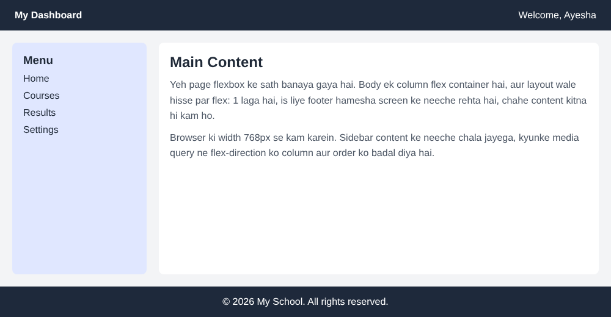

**Mobile:** Content pehle, sidebar neeche (media query + `order`).

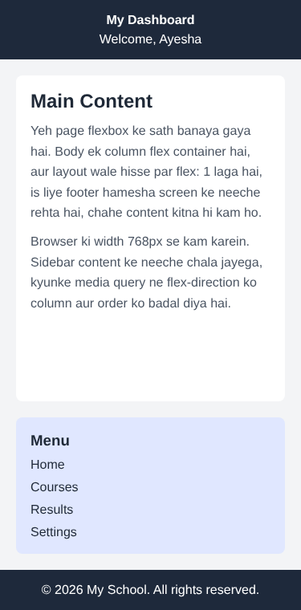

```html
<!DOCTYPE html>
<html lang="en">
<head>
  <meta charset="UTF-8">
  <meta name="viewport" content="width=device-width, initial-scale=1.0">
  <title>Project 4: Full Page Layout (Sidebar + Sticky Footer)</title>
  <style>
    * { box-sizing: border-box; margin: 0; padding: 0; }

    body {
      font-family: Arial, sans-serif;
      min-height: 100vh;
      display: flex;
      flex-direction: column;            /* header, content, footer ek ke neeche */
      color: #1f2937;
    }

    header, footer {
      padding: 16px 24px;
      background: #1e293b;
      color: #fff;
    }

    header {
      display: flex;
      justify-content: space-between;
      align-items: center;
    }

    /* ---------- Beech ka hissa: sidebar + main ---------- */
    .layout {
      flex: 1;                           /* bachi hui poori height le lo (sticky footer) */
      display: flex;                     /* sidebar aur main ek row mein */
      gap: 20px;
      padding: 20px;
      background: #f3f4f6;
    }

    aside {
      flex: 0 0 220px;                   /* sidebar ki fixed width 220px */
      padding: 18px;
      background: #e0e7ff;
      border-radius: 8px;
    }
    aside ul { list-style: none; display: flex; flex-direction: column; gap: 10px; margin-top: 10px; }

    main {
      flex: 1;                           /* baaki saari width */
      padding: 18px;
      background: #fff;
      border-radius: 8px;
    }
    main h2 { margin-bottom: 10px; }
    main p  { margin-bottom: 10px; line-height: 1.6; color: #4b5563; }

    footer { text-align: center; }

    /* ---------- Mobile: 768px ya us se kam ---------- */
    @media (max-width: 768px) {
      .layout { flex-direction: column; }         /* sidebar aur main ek ke neeche */
      aside   { flex: 0 0 auto; order: 2; }       /* sidebar ab main ke BAAD aayega */
      main    { order: 1; }
      header  { flex-direction: column; gap: 6px; }
    }
  </style>
</head>
<body>

  <header>
    <strong>My Dashboard</strong>
    <span>Welcome, Ayesha</span>
  </header>

  <div class="layout">
    <aside>
      <h3>Menu</h3>
      <ul>
        <li>Home</li>
        <li>Courses</li>
        <li>Results</li>
        <li>Settings</li>
      </ul>
    </aside>

    <main>
      <h2>Main Content</h2>
      <p>Yeh page flexbox ke sath banaya gaya hai. Body ek column flex container hai, aur layout wale hisse par flex: 1 laga hai, is liye footer hamesha screen ke neeche rehta hai, chahe content kitna hi kam ho.</p>
      <p>Browser ki width 768px se kam karein. Sidebar content ke neeche chala jayega, kyunke media query ne flex-direction ko column aur order ko badal diya hai.</p>
    </main>
  </div>

  <footer>&copy; 2026 My School. All rights reserved.</footer>

</body>
</html>
```

**Challenge:** Sidebar ke menu items ko mobile par ek row (`flex-direction: row` aur `flex-wrap: wrap`) mein dikhayen.

---

## 13. Practice Tasks

1. Ek container mein 4 boxes banayen. `flex-direction` ki chaaron values (`row`, `row-reverse`, `column`, `column-reverse`) laga kar dekhein.
2. `justify-content` ki 6 values ek ek kar ke laga kar farq note karein.
3. Container ki `height: 300px` dein aur `align-items` ki 5 values try karein.
4. 10 boxes banayen aur `flex-wrap: wrap` ke sath `gap` lagayen. Browser ki width kam zyada karein.
5. Teen boxes mein `flex-grow` ki values `1`, `2`, `1` dein aur widths measure karein (DevTools mein).
6. Ek box ko `order: -1` dein aur dekhein wo kahan jata hai.
7. Ek page ke beech mein ek card ko flexbox se bilkul center karein (horizontal aur vertical).
8. Ek navbar banayen jis mein logo left aur teen links right par hon (`margin-left: auto` ya `space-between` se).
9. Apni navbar ko mobile par column mein badlein (`@media (max-width: 768px)`).
10. Cards ka grid banayen jo mobile par 1, tablet par 2 aur desktop par 3 columns dikhaye.
11. `flex-direction: column` kar ke `justify-content: center` aur `align-items: center` dono try karein. Dekhein kaun si property kis direction mein kaam kar rahi hai.
12. DevTools mein Device Toolbar (`Ctrl + Shift + M`) se apne page ko 375px, 768px aur 1200px par test karein.

---

## 14. Useful Resources

| Resource | Kis liye |
|----------|----------|
| [Flexbox Froggy](https://flexboxfroggy.com/) | Game khelte hue flexbox seekhna (student practice ke liye behtareen) |
| [CSS-Tricks: A Complete Guide to Flexbox](https://css-tricks.com/snippets/css/a-guide-to-flexbox/) | Poori reference guide |
| [MDN: flex](https://developer.mozilla.org/en-US/docs/Web/CSS/flex) | Official documentation |

---

**Happy Learning!** Agar koi sawal ho to class mein pooch lein.
